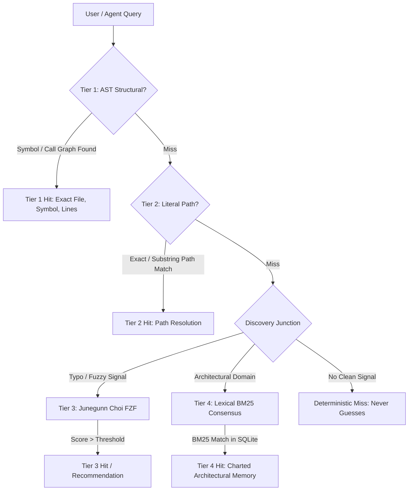

# 4-Tier Discovery Architecture

Waymark Engine separates code discovery into four distinct tiers, combining raw-source deterministic structural indexing with frontloaded lexical architectural memory.

---

## Tier 1: AST Structural Call Graph

- **Core Engine**: `@paragon-ux/codedb-core` (deterministic structural fork of codedb) and `web-tree-sitter`.
- **Latency**: `<10ms` (daemon warm cache) / `150–250ms` (cold process scan).
- **Execution**: Direct AST parsing and symbol graph extraction. Identifies exact function callers, callees, class methods, and type definitions.

### Multi-Hop BFS Call Graphs
Waymark supports bounded multi-hop traversals:
- **Depth**: Configurable from 1 to 5 hops.
- **Direction**: `callers`, `callees`, or `both`.
- **Test Exclusion**: `--exclude-tests` suppresses `tests/`, `*_test.*`, and `*.spec.*` files from call graphs, yielding up to **94% token savings** without losing architectural caller paths.

### Single-File AST Outlines
For a single file (`--path <file>`), Waymark invokes native Tree-Sitter grammar trees to generate structured JSON outlines with symbols, line spans, parameters, and decorators.

---

## Tier 2: Literal Path Router

- **Core Engine**: Embedded in-memory `PrefixTrie`.
- **Latency**: `<1ms`.
- **Execution**: Resolves full paths, relative paths, and fuzzy basenames (e.g., `daemon.ts` -> `src/daemon.ts`).
- **Fail-Closed Guarantee**: If a path does not exist, Tier 2 refuses to extrapolate. It emits a clean miss immediately.

---

## Tier 3: Deterministic Fuzzy Matcher

- **Core Engine**: Embedded Junegunn Choi `fzf` algorithm (`algo.go` ported to native TypeScript).
- **Dependency Footprint**: Zero external dependencies, pure standard library.
- **Scoring**: Two-pass fuzzy scoring:
  1. Forward pass identifies substring match boundaries.
  2. Backward pass calculates optimal character scoring with bonus points for leading characters, path separators (`/`), camelCase boundaries, and word starts.
- **Determinism**: Identical inputs yield bit-exact scores across platforms.

---

## Tier 4: Semantic Repo Map (Consensus Ledger)

- **Core Engine**: `@paragon-ux/capn-hook` (lexical-only fork of capn-hook) and SQLite (`.waymark/memory`).
- **Recall Algorithm**: Pure lexical **BM25** ranking.
- **Zero-Embedding Invariant**: Refuses vector stores or embedding models (`CAPN_STORE_UNINITIALIZED` and `CAPN_NON_DETERMINISTIC_MODE` fail-closed guards).

### The 5 Architectural Facets
Consensus memories are structured across 5 distinct domains:

| Facet | Domain | Example Question |
| :--- | :--- | :--- |
| `lifecycle` | Startup, shutdown, process management | "How does the daemon start and shut down?" |
| `data_state` | State stores, caching, migrations | "Where is the in-memory trie cache held?" |
| `boundaries` | IPC protocols, network APIs, CLI/MCP surfaces | "What protocol connects the REPL to the daemon?" |
| `invariants` | Security rules, fail-closed guards, constraints | "What prevents non-deterministic recall?" |
| `failure` | Error handling, fallback fallbacks, timeouts | "How does the engine handle missing tree-sitter grammars?" |

---

## The Discovery Junction

When Tier 1 (AST) and Tier 2 (Literal Path) miss, the query enters the **Discovery Junction**.

Rather than returning an empty response or hallucinating an answer, the Discovery Junction analyzes syntactic candidate signals:
- If a token resembles an existing symbol with high Levenshtein / `fzf` similarity, it emits a `status: "junction"` recommendation suggesting the exact symbol.
- If the query targets conceptual architecture, it routes to Tier 4 BM25 consensus.
- If no candidate crosses confidence thresholds, it emits a clean miss.

> [!IMPORTANT]
> **A clean miss is a miss — never a guess.** Coding agents require predictable failure boundaries so they can pivot rather than act on fabricated code locations.

---

## Polyglot Language Support & Tier Fallback Matrix

Waymark Engine combines three extraction layers with explicit fail-closed boundaries so agents always know what is structurally indexed vs. lexically recalled:

### 1. Single-File AST Outlines (`waymark ask --outline --path <file>` / `waymark_ask(path, outline=true)`)

| Language / Format | File Extensions | Extraction Engine | Fidelity & Symbols Extracted |
| :--- | :--- | :--- | :--- |
| **TypeScript** | `.ts`, `.tsx`, `.mts`, `.cts` | Native Tree-Sitter (`tree-sitter-typescript.wasm`) | Exact line + column spans for classes, methods, functions (including arrow functions), interfaces, and type aliases |
| **JavaScript** | `.js`, `.jsx`, `.mjs`, `.cjs` | Native Tree-Sitter (`tree-sitter-javascript.wasm`) | Exact line + column spans for classes, methods, functions, and arrow/function expressions (filters out local variable noise) |
| **Python** | `.py` | Native Tree-Sitter (`tree-sitter-python.wasm`) | Exact line + column spans for classes, methods, functions, and module-level assignments (`variable`, including tuple/pattern-list unpacking while excluding class-local, function-local, and control-flow-nested assignments) |
| **Markdown** | `.md`, `.markdown`, `.mdx` | Native `markdown-it` AST Parser | Monotonic stack extraction of `h1`–`h6` sections (`section`), tables (`table`), `<tbody>` data rows (`table_row` as `row:<first-cell>`, disambiguated as `row:<first-cell> (L<line>)` when repeated across rows or when colliding with `L<line>` / `(L<line>)` syntax, and `row:L<line>` when empty), and fenced code blocks (`code_block` as `fence:L<startLine>`) with inclusive full-line character spans (`column: 0` to `end.line` character length) |
| **JSON** | `.json` | Native Tree-Sitter (`tree-sitter-json.wasm`) | Object properties (`config_block`), top-level and nested array-of-object items (`config_item`, keyed by `id`/`name`/`key`/`*_id` as `prefix[id]`, disambiguated into disjoint namespaces as `prefix[id#idx]` when duplicated across elements, conflicting within an object, numeric-only, or ending in `#<digits>`, and falling back to `prefix[idx]` when unnamed; fails closed with `OUTLINE_LIMIT_EXCEEDED` above 500 array items), escaped & unicode key decoding, and exact value coordinates |
| **TOML** | `.toml` | Native Tree-Sitter (`tree-sitter-toml.wasm`) | Table headers, array-of-tables (`[[plugins]]`), and nested key-value coordinates |
| **YAML** | `.yaml`, `.yml` | Native Tree-Sitter (`tree-sitter-yaml.wasm`) | Multi-document streams, flow mappings, and scalar structures with recursion guard |
| **Bash** | `.sh`, `.bash`, `.zsh` | Native Tree-Sitter (`tree-sitter-bash.wasm`) | Shell functions, exported routines, and script blocks |
| **C#** | `.cs` | Native Tree-Sitter (`tree-sitter-c_sharp.wasm`) | Exact line + column spans for classes, interfaces, structs, enums, records, methods, constructors, and properties |
| **Scala** | `.scala` | Native Tree-Sitter (`tree-sitter-scala.wasm`) | Exact line + column spans for classes, objects, traits, and methods |
| **Lua** | `.lua` | Native Tree-Sitter (`tree-sitter-lua.wasm`) | Exact line + column spans for global, local, and table/method functions |
| **Zig** | `.zig` | Native Tree-Sitter (`tree-sitter-zig.wasm`) | Exact line + column spans for functions, methods, structs, and enums |
| **Elixir** | `.ex`, `.exs` | Native Tree-Sitter (`tree-sitter-elixir.wasm`) | Exact line + column spans for modules (`defmodule`), functions (`def`/`defp`), and protocols |
| **Solidity** | `.sol` | Native Tree-Sitter (`tree-sitter-solidity.wasm`) | Exact line + column spans for contracts, interfaces, structs, enums, constructors, functions, and modifiers |
| **Rust** | `.rs` | Native Tree-Sitter (`tree-sitter-rust.wasm`) | Exact line + column spans for structs, enums, traits, impl methods, functions, and type aliases |
| **Go** | `.go` | Native Tree-Sitter (`tree-sitter-go.wasm`) | Exact line + column spans for structs, interfaces, methods, functions, and types |
| **Java** | `.java` | Native Tree-Sitter (`tree-sitter-java.wasm`) | Exact line + column spans for classes, interfaces, records, enums, constructors, and methods |
| **C** | `.c`, `.h` | Native Tree-Sitter (`tree-sitter-c.wasm`) | Exact line + column spans for functions, structs, and enums |
| **C++** | `.cpp`, `.hpp`, `.cc`, `.cxx` | Native Tree-Sitter (`tree-sitter-cpp.wasm`) | Exact line + column spans for classes, structs, enums, methods, constructors, and functions |
| **Ruby** | `.rb` | Native Tree-Sitter (`tree-sitter-ruby.wasm`) | Exact line + column spans for classes, modules, instance methods, and singleton methods |
| **Swift** | `.swift` | Native Tree-Sitter (`tree-sitter-swift.wasm`) | Exact line + column spans for classes, structs, enums, protocols, constructors, methods, and functions |
| **Kotlin** | `.kt` | Native Tree-Sitter (`tree-sitter-kotlin.wasm`) | Exact line + column spans for classes, interfaces, objects, enums, methods, and properties |
| **PHP** | `.php` | Native Tree-Sitter (`tree-sitter-php.wasm`) | Exact line + column spans for classes, interfaces, traits, enums, methods, and functions |
| **Polyglot Fallback Guard** | `.rs`, `.go`, `.java`, `.c`, `.cpp`, `.rb`, `.swift`, `.kt`, `.php` | Polyglot `codedb outline` Fallback (`@paragon-ux/codedb-core`) | Fail-safe secondary outline if WASM grammar is unavailable in host environment |
| **Unsupported & Dialect Extensions** | `.dart`, `.sql`, `.jsonc`, `.json5`, etc. | Fail-Closed Guard | Rejects single-file AST extraction with `UNSUPPORTED_LANGUAGE` (never returns a silent `0 symbols` false positive; Dart ABI 15 fail-closed) |

> **Semantic Uniqueness, Coordinate Semantics & Position-Stability Contract**: Waymark outlines provide deterministic structural discovery coordinates (`line`, `endLine`, `column`, `endColumn`), not immutable content-addressed identities. When an identifier is unique within its scope (e.g., `tenants[ten_006]` or `row:CHK-14-C`), its symbol name is stable across line shifts. To prevent final-name collisions in JSON object arrays (`MAX_JSON_ARRAY_ITEMS = 500`, above which Waymark fails closed with `OUTLINE_LIMIT_EXCEEDED` rather than returning an incomplete outline), Waymark partitions bracket labels into three pairwise-disjoint namespaces: unnamed elements emit `prefix[idx]`, unambiguous non-numeric identifiers emit `prefix[id]`, and any element that is duplicated across array elements (counting all identifying values on multi-key objects), declares conflicting/invalid identifying keys, has a pure-numeric ID (`/^\d+$/`), or ends with `#<digits>` (`/#\d+$/`) emits `prefix[id#idx]`. Similarly, Markdown `table_row` symbols (`row:<first-cell>`) disambiguate repeated first-cell identifiers or literal cells matching `L<digits>` / `...(L<digits>)` as `row:<first-cell> (L<startLine>)`. Markdown symbols (`section`, `table`, `table_row`, `code_block`) emit inclusive full-line bounds (`start.column = 0` on `start.line` through `end.column = lines[end.line - 1].length` on `end.line`). Downstream editing substrates must treat Markdown scopes as line-bounded observations and re-verify spans against current file contents before applying mutations.

### 2. Repo-Wide Call Graph & Symbol Search (`waymark ask "<symbol>"` / `waymark_ask(query | symbols)`)
- **Indexed by `@paragon-ux/codedb-core`**: `.ts`, `.tsx`, `.js`, `.jsx`, `.py`, `.rs`, `.go`, `.java`, `.rb`, `.swift`, `.kt` (plus partial `.c`/`.cpp`/`.php`).
- **In-Process Tree-Sitter Repo-Wide Fallback (`.mjs`, `.cjs`, `.mts`, `.cts`, `.toml`)**: Because the upstream `codedb` scanner only indexes `.ts`/`.tsx`/`.js`/`.jsx`, Waymark automatically supplements repo-wide symbol search, call graphs, architecture summaries, batch `--symbols`, and fuzzy candidates with in-process `web-tree-sitter` indexing across `.mjs`, `.cjs`, `.mts`, `.cts`, and `.toml`.

### 3. Tiers 2, 3, and 4 (100% Language-Agnostic)
- **Tier 2 (`PrefixTrie` Path Router)**: Resolves exact and basename paths for **any** file extension in `<1ms`.
- **Tier 3 (`fzf` Fuzzy Matcher)**: Scores path and token candidates across **all** tracked files.
- **Tier 4 (`.waymark/memory` BM25 Consensus Memory & 5-Facet Semantic Repo Map)**: Charts and recalls verified `<100`-token architectural answers with SHA-256 file drift tracking for **any** language or file type.

---

## Host Protection Invariants

To keep the host developer environment responsive during intensive AST parsing:
- **Thread Capping**: `CODEDB_MAX_THREADS` automatically defaults to `Math.max(1, os.cpus().length - 1)`, reserving 1 logical core for the host OS and editor.
- **Process Isolation**: External tools are invoked with explicit `argv` arrays (never via a shell string).
