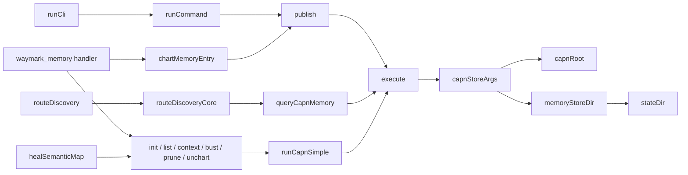

# `architectural-map`

Traces a feature's call chain with the AST tier, checks it against the source, and charts the result as consensus memory.

## Invoke

```text
/waymark-engine:architectural-map capnStoreArgs
```

| Argument | Required | Value |
| :--- | :--- | :--- |
| `topic` | yes | `capnStoreArgs` |
| `root` | no | not set |

Without `topic`, the prompt fails with JSON-RPC `-32602` instead of tracing a placeholder.

## What the prompt sends

> Map the architectural call chain and execution flow for: "capnStoreArgs".
> 1. Find the entry symbols: waymark_ask(question: "capnStoreArgs", plain: true), and waymark_ask(query: "architecture", plain: true) for the repository layout.
> 2. Trace each symbol: waymark_ask(query: "&lt;symbol&gt;", depth: 2, direction: "both", plain: true). A bare symbol with depth or direction is traced as a call graph; "who calls &lt;symbol&gt;" or "trace &lt;symbol&gt;" also works.
> 3. Verify exact file paths and spans: waymark_ask(path: "&lt;file&gt;", outline: true, plain: true).
> 4. Chart the verified flow: waymark_memory(action: "chart", question: "&lt;focused question&gt;", answer: "&lt;summary&gt;", files: ["&lt;backing file&gt;", ...]).

## 1. Find the symbol

`waymark_ask`:

```json
{ "question": "capnStoreArgs", "plain": true }
```

```text
[hit: codedb] (confidence: exact)
total: 1
results: 1 (cols: qn label file lines)
  capnStoreArgs function src/capnAdapter.ts 101
```

## 2. Callers

A bare symbol with `depth` or `direction` is traced as a call graph:

```json
{ "query": "capnStoreArgs", "depth": 4, "direction": "callers", "exclude_tests": true, "plain": true }
```

```text
[call-graph: depth 4]
capnStoreArgs (src/capnAdapter.ts:101)
  ↳ callers:
      - execute (src/capnAdapter.ts:133)
      ↳ callers:
          - publish (src/capnAdapter.ts:215)
          ↳ callers:
              - runCommand (src/cli.ts:150)
              ↳ callers:
                  - runCli (src/cli.ts:676)
              - chartMemoryEntry (src/semanticMap.ts:711)
              ↳ callers:
                  - waymarkMemoryTool.handler [method] (src/mcp/capnTools.ts:351)
              - waymarkChartTool.handler [method] (src/mcp/capnTools.ts:548)
          - queryCapnMemory (src/capnAdapter.ts:311)
          ↳ callers:
              - routeDiscoveryCore (src/discoveryRouter.ts:516)
              - routeDiscovery (src/discoveryRouter.ts:1238)
              ↳ callers:
                  - ask (src/capnAdapter.ts:378)
          - runCapnSimple (src/capnAdapter.ts:440)
          ↳ callers:
              - unchart (src/capnAdapter.ts:459)
              ↳ callers:
                  - healSemanticMap (src/semanticMap.ts:621)
                  - waymarkUnchartTool.handler [method] (src/mcp/capnTools.ts:693)
              - bust (src/capnAdapter.ts:474)
              ↳ callers:
                  - waymarkBustTool.handler [method] (src/mcp/capnTools.ts:730)
              - prune (src/capnAdapter.ts:481)
              ↳ callers:
                  - waymarkPruneTool.handler [method] (src/mcp/capnTools.ts:761)
              - listEntries (src/capnAdapter.ts:487)
              ↳ callers:
                  - waymarkListTool.handler [method] (src/mcp/capnTools.ts:790)
              - context (src/capnAdapter.ts:514)
              ↳ callers:
                  - waymarkContextTool.handler [method] (src/mcp/capnTools.ts:819)
              - initCapn (src/capnAdapter.ts:574)
              ↳ callers:
                  - waymarkInitTool.handler [method] (src/mcp/capnTools.ts:911)
              - migrateMemoryStore (src/capnAdapter.ts:590)
```

## 3. Callees

```json
{ "query": "capnStoreArgs", "depth": 2, "direction": "callees", "plain": true }
```

```text
[call-graph: depth 2]
capnStoreArgs (src/capnAdapter.ts:101)
  ↳ callees:
      - capnRoot (src/capnAdapter.ts:111)
      - memoryStoreDir (src/stateDir.ts:21)
      ↳ callees:
          - stateDir (src/stateDir.ts:12)
```

## 4. Verify against the source

The prompt asks for exact file paths, so each edge was checked against the code:

| Claim | Source | Result |
| :--- | :--- | :--- |
| `execute` is the only caller of `capnStoreArgs` | `src/capnAdapter.ts:134` | Confirmed |
| `execute` runs capn with the symlink-resolved root as its working directory | `src/capnAdapter.ts:135` | Confirmed |
| Both `queryCapnMemory` call sites are in `routeDiscoveryCore` | `src/discoveryRouter.ts:862`, `:1044` | Confirmed |
| `routeDiscovery` → `queryCapnMemory` is the injected `ctx.queryCapnMemory` it wraps to report pruned entries | `src/discoveryRouter.ts:1244-1250` | Confirmed: the call goes through the context, and `capnAdapter.ask` passes `queryCapnMemory` in |
| `waymark_memory` charts through `chartMemoryEntry`, which calls `publish` | `src/mcp/capnTools.ts:375`, `src/semanticMap.ts:727` | Confirmed |
| `waymark memory chart` on the CLI also reaches `chartMemoryEntry` | `src/cli.ts:351` | Confirmed. The graph doesn't show this edge because the CLI loads `chartMemoryEntry` with a dynamic `import()`. Its `runCommand` → `publish` edge is the legacy `waymark chart` command (`src/cli.ts:483`). |

`[method]` marks a class or object method. A method node is named after the object that holds it, such as `waymarkMemoryTool.handler`.

## 5. Chart the result

`waymark_memory`:

```json
{
  "action": "chart",
  "question": "How does every capn invocation get --root and --store-dir?",
  "answer": "capnStoreArgs(root) returns [\"--root\", realpath(root), \"--store-dir\", memoryStoreDir(realpath)]. Its only caller, execute(), puts them before the subcommand and spawns capn with that realpath as cwd. All capn traffic goes through execute: publish (chart), queryCapnMemory (Tier 4 recall), runCapnSimple (init, list, context, bust, prune, unchart). A \"Usage:\" reply becomes CAPN_STORE_DIR_UNSUPPORTED.",
  "files": ["src/capnAdapter.ts", "src/stateDir.ts"],
  "facet": "boundaries"
}
```

```json
{
  "waymark": 1,
  "kind": "chart",
  "published": true,
  "adapter": "capn-cli",
  "output": "charted 3ca79ca8\n",
  "question": "[FACET:BOUNDARIES] How does every capn invocation get --root and --store-dir?",
  "facet": "boundaries"
}
```

The facet tags the question. Charting the same facet again replaces this entry, and the result lists the replaced id under `replaced`.

## 6. Recall it

A later session asks in different words, and Tier 4 answers:

```json
{ "question": "how does capn get its store dir?", "tier": "capn" }
```

```json
{
  "waymark": 1,
  "kind": "ask",
  "provider": "capn-cli",
  "status": "hit",
  "result": {
    "id": "3ca79ca8",
    "question": "[FACET:BOUNDARIES] How does every capn invocation get --root and --store-dir?",
    "files": ["src/capnAdapter.ts", "src/stateDir.ts"],
    "score": 50
  }
}
```

The `details` field, which holds the charted answer, is omitted here. Once `src/capnAdapter.ts` or `src/stateDir.ts` changes, `waymark_memory(action: "status")` reports the facet as `drifted`, and capn deletes the entry on its next recall. That recall names the deleted entry under `memoryPruned`.

## The map


