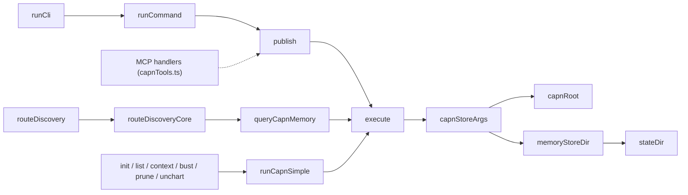

# `architectural-map`

Traces a feature's call chain with the AST tier, checks it against the source, and charts the result as consensus memory.

## Invoke

```text
/waymark-engine:architectural-map capnStoreArgs
```

| Argument | Required | Value |
| :--- | :--- | :--- |
| `topic` | yes | `capnStoreArgs` |
| `root` | no | not set (added in `16449e4`, after this run) |

## What the prompt sends

> Trace the architectural call chain and execution flow for: "capnStoreArgs". Use waymark_ask to resolve callers and callees (arguments: depth, direction), verify exact file paths, and summarize the consensus policy in long-term memory via waymark_memory (action: "chart", or waymark_chart).

## 1. Callers

`waymark_ask`:

```json
{ "question": "Who calls capnStoreArgs?", "depth": 4, "direction": "callers", "exclude_tests": true, "plain": true }
```

```text
[call-graph: depth 4]
capnStoreArgs (src/capnAdapter.ts:100)
  ↳ callers:
      - execute (src/capnAdapter.ts:132)
      ↳ callers:
          - publish (src/capnAdapter.ts:214)
          ↳ callers:
              - runCommand (src/cli.ts:150)
              ↳ callers:
                  - runCli (src/cli.ts:720)
          - queryCapnMemory (src/capnAdapter.ts:329)
          ↳ callers:
              - routeDiscoveryCore (src/discoveryRouter.ts:475)
              ↳ callers:
                  - routeDiscovery (src/discoveryRouter.ts:1112)
          - runCapnSimple (src/capnAdapter.ts:453)
          ↳ callers:
              - unchart (src/capnAdapter.ts:472)
              - bust (src/capnAdapter.ts:487)
              - prune (src/capnAdapter.ts:494)
              - listEntries (src/capnAdapter.ts:500)
              - context (src/capnAdapter.ts:517)
              - initCapn (src/capnAdapter.ts:555)
              - migrateMemoryStore (src/capnAdapter.ts:571)
```

## 2. Callees

```json
{ "question": "Callees of capnStoreArgs", "depth": 2, "direction": "callees", "plain": true }
```

```text
[call-graph: depth 2]
capnStoreArgs (src/capnAdapter.ts:100)
  ↳ callees:
      - capnRoot (src/capnAdapter.ts:110)
      - memoryStoreDir (src/stateDir.ts:21)
      ↳ callees:
          - stateDir (src/stateDir.ts:12)
```

## 3. Verify against the source

The prompt asks for exact file paths, so each edge was checked by reading the code. A text search for each callee's call sites showed:

| Claim | Source | Result |
| :--- | :--- | :--- |
| `execute` is the only caller of `capnStoreArgs` | `src/capnAdapter.ts:133` | Confirmed |
| `execute` runs capn with the symlink-resolved root as its working directory | `src/capnAdapter.ts:134` | Confirmed |
| Both `queryCapnMemory` call sites are in `routeDiscoveryCore` | `src/discoveryRouter.ts:754`, `:918` | Confirmed |
| `publish` is called only from the CLI | `src/mcp/capnTools.ts:387` (`waymark_memory`), `:584` (`waymark_chart`) | **Missed by the graph** |

The MCP tools call `publish` from anonymous `handler` functions, and the AST tier only reports named callers. A call graph alone would have suggested that charting is CLI-only.

## 4. Chart the result

`waymark_memory`:

```json
{
  "action": "chart",
  "question": "How does every capn invocation get --root and --store-dir?",
  "answer": "capnStoreArgs(root) returns [\"--root\", realpath(root), \"--store-dir\", memoryStoreDir(realpath)]. Its only caller, execute(), puts them before the subcommand and spawns capn with that realpath as cwd. All capn traffic goes through execute: publish (chart), queryCapnMemory (Tier 4 recall), runCapnSimple (init, list, context, bust, prune, unchart). A \"Usage:\" reply becomes CAPN_STORE_DIR_UNSUPPORTED.",
  "files": ["src/capnAdapter.ts", "src/stateDir.ts"],
  "facet": "boundaries"
}
```

```json
{ "published": true, "adapter": "capn-cli", "output": "charted 3ca79ca8\n" }
```

## 5. Recall it

A later session asks in different words, and Tier 4 answers:

```json
{ "question": "how does capn get its store dir?", "tier": "capn" }
```

```json
{
  "provider": "capn-cli",
  "status": "hit",
  "result": {
    "id": "3ca79ca8",
    "question": "[FACET:BOUNDARIES] How does every capn invocation get --root and --store-dir?",
    "files": ["src/capnAdapter.ts", "src/stateDir.ts"],
    "score": 50
  }
}
```

The `details` field, which holds the charted answer, is omitted here. The entry is deleted automatically once `src/capnAdapter.ts` or `src/stateDir.ts` changes.

## The map



The dashed edge was found by reading the source. The call graph doesn't report it.
